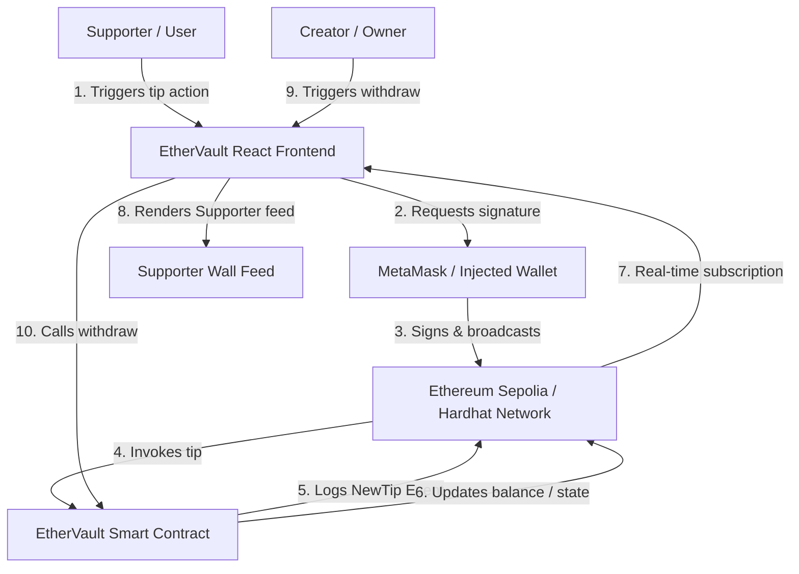
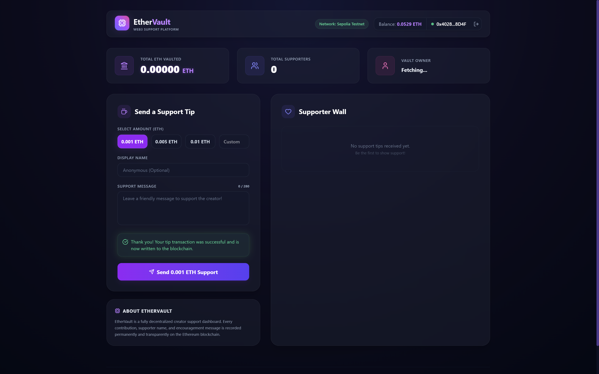
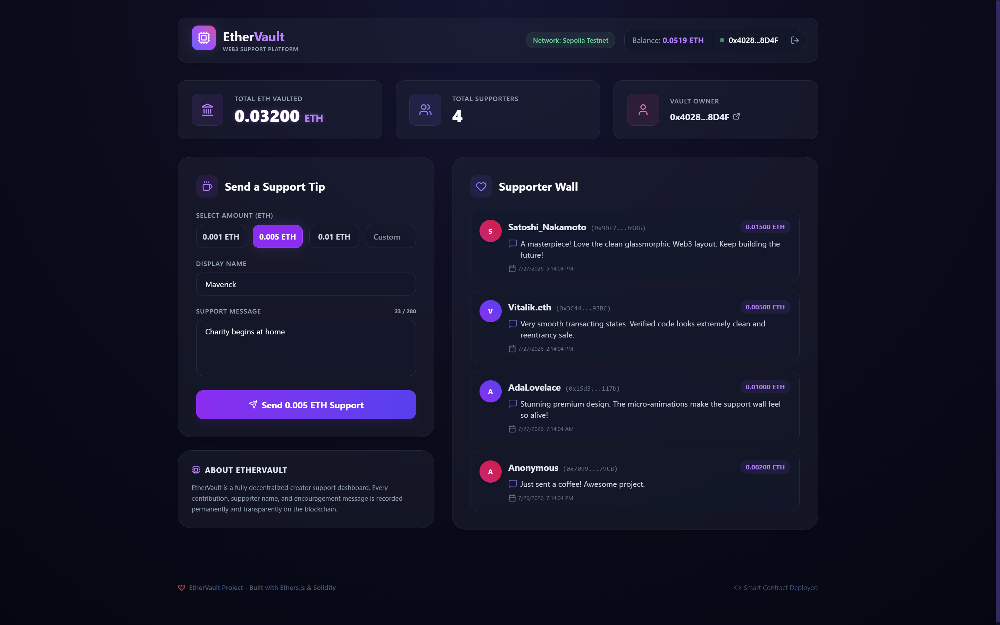

# EtherVault - Decentralized Creator Support & Live Supporter Wall

[](https://opensource.org/licenses/MIT)
[](https://soliditylang.org/)
[](https://vite.dev/)
[](https://docs.ethers.org/v6/)

**EtherVault** is a Web3 platform enabling creators to receive support tips in Ether directly from their audience. Every supporter name, tipped amount, and encouraging message is recorded permanently and transparently on the Ethereum blockchain, powering a real-time Supporter Wall.

---

## System Overview & Architecture



---

## Preview & Screenshots

<p align="center">
  
  
</p>

---

## Prerequisites

Before starting, ensure you have the following installed:
- **Node.js** (v18.0.0 or higher)
- **NPM** (v9.0.0 or higher)
- **MetaMask browser extension** (or similar injected Web3 wallet provider)

---

## Environment Variables Guide

Copy the example configuration to create your local environment file:
```bash
cp .env.example .env
```

Define the following environment variables inside `.env`:
```ini
# JSON-RPC Endpoint URL (e.g., from Infura, Alchemy, or a public node provider)
SEPOLIA_RPC_URL=https://sepolia.infura.io/v3/YOUR_INFURA_PROJECT_ID

# Deployer wallet private key (omit the "0x" prefix)
PRIVATE_KEY=your_private_key_without_0x_prefix

# Etherscan API Key (required for verify contract code)
ETHERSCAN_API_KEY=your_etherscan_api_key_for_contract_verification
```

---

## Step-by-Step Setup & Local Development

### 1. Install Dependencies
Clone the repository and install all packages:
```bash
npm install
```

### 2. Run Smart Contract Tests
Ensure the Solidity compiler and unit tests run successfully:
```bash
npx hardhat test
```

### 3. Deploy to Local hardhat Node
Start a local Hardhat simulated network:
```bash
npx hardhat node
```
Open a new terminal window and deploy the contract to localhost:
```bash
npx hardhat run scripts/deploy.js --network localhost
```
This automatically updates `src/config/contract.json` with the deployed address and ABI.

### 4. Start React Frontend
Run the local Vite development server:
```bash
npm run dev
```
Open your browser and navigate to `http://localhost:5173`. Connect your MetaMask wallet to the **Localhost Network (RPC URL: `http://127.0.0.1:8545`, Chain ID: `31337`)** to interact with the contract.

---

## Smart Contract Deployment & Verification on Sepolia

To deploy to the Sepolia Ethereum Testnet:

1. Ensure your `.env` contains valid private keys and a Sepolia RPC node URL.
2. Run the deployment script using the `--network sepolia` flag:
   ```bash
   npx hardhat run scripts/deploy.js --network sepolia
   ```
3. Verify your contract source code on Etherscan for audit visibility:
   ```bash
   npx hardhat verify --network sepolia DEPLOYED_CONTRACT_ADDRESS
   ```

---

## Folder Structure & Key Files

- [EtherVault.sol](file:///m:/Git_hub_Projects/Ether_Vault/contracts/EtherVault.sol): Solidity smart contract incorporating tips, events, reentrancy guards, and helper view functions.
- [deploy.js](file:///m:/Git_hub_Projects/Ether_Vault/scripts/deploy.js): Compilation and deployment script which writes addresses and ABIs to the frontend folder.
- [EtherVault.test.js](file:///m:/Git_hub_Projects/Ether_Vault/test/EtherVault.test.js): Chai unit tests covering all edge cases, validations, permissions, and reentrancy checks.
- [App.jsx](file:///m:/Git_hub_Projects/Ether_Vault/src/App.jsx): Frontend wrapper integrating wallet state, Ethers v6 read/write helpers, event listeners, and layouts.

---

## License

This project is licensed under the [MIT License](LICENSE).
